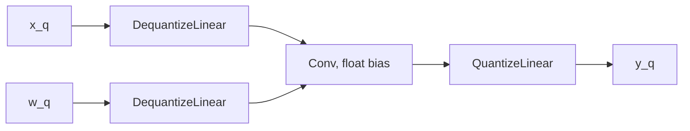

# ONNX QDQ-to-QLinear conversion

[`convert_qdq_to_qlinear_onnx`](conversion.py) rewrites recognized quantized
ONNX patterns into the operator representation consumed by the standalone VTA
frontend. It runs after PyTorch PT2E conversion and ONNX export. It neither
trains the model nor recalibrates its activation scales.

The converter currently targets scalar scales, explicit zero-points, signed
INT8 tensors and the single-input/single-output graphs produced by the training
pipeline. It is not a general converter for arbitrary QDQ graphs. Some
conditions below are assumed rather than checked; known counterexamples are
included in the tests.

## Run conversion separately

The training pipeline invokes the function automatically. To convert an
existing LeNet5 QDQ export from the repository root:

```bash
pixi run -e training python - <<'PY'
from pathlib import Path
import onnx
from src.training.onnx_utils import convert_qdq_to_qlinear_onnx

output = Path("compiler_output/onnx_conversion/lenet5_qlinear.onnx")
output.parent.mkdir(parents=True, exist_ok=True)
convert_qdq_to_qlinear_onnx(
    "training_output/LeNet5/vta_cnn_qdq.onnx", str(output)
)
onnx.checker.check_model(onnx.load(output), full_check=True)
PY
```

The QDQ file and any external weight file must be present. This example checks
graph validity; numerical output comparison is a separate step described below.

## What QDQ and QLinear mean

For a positive scalar scale `s` and an INT8 zero-point `z`, the quantization
boundaries represent:

```text
Q(x; s, z)  = clip(round_to_nearest_even(x / s) + z, -128, 127)
DQ(q; s, z) = (float32(q) - z) * s
```

A QDQ graph expresses quantization with explicit QuantizeLinear and
DequantizeLinear nodes around ordinary float operators. Its weights may already
be INT8 initializers even though its Conv nodes consume dequantized floats.
A QLinear graph passes quantized tensors and their scales/zero-points directly
to quantized operators. ONNX Runtime calls these representations QDQ and
QOperator; see its [quantization documentation](https://onnxruntime.ai/docs/performance/model-optimizations/quantization.html).

A convolution pattern becomes:



```text
QLinearConv(x_q, x_scale, x_zero_point,
            w_q, w_scale, w_zero_point,
            y_scale, y_zero_point, optional_int32_bias) -> y_q
```

For the quantized convolution, the conceptual accumulator and output are:

```text
acc = sum((x_q - x_zero_point) * (w_q - w_zero_point)) + bias_q
y_q = saturate(round(acc * x_scale * w_scale / y_scale) + y_zero_point)
```

The precise arithmetic of a runtime kernel can differ from float Conv followed
by Q near rounding boundaries. This formula is not a promise of bit-exact
agreement with every ONNX Runtime kernel or VTA execution path.

## Graph transformations in this implementation

| Matched float pattern | Replacement | Numerical condition or limitation |
| --- | --- | --- |
| `DQ(x), DQ(w) -> Conv -> Q` | Standard ONNX `QLinearConv` | Scalar scales; representable bias for exact equivalence; kernel rounding may differ |
| `DQ(x), DQ(w) -> Conv -> Relu -> Q` | `QLinearConv`, with the ReLU removed | ReLU removal requires the output range to enforce the real lower bound zero |
| `DQ(x), DQ(y) -> Add -> Q` | `com.microsoft::QLinearAdd` | Carries both input scales/zero-points and the output scale/zero-point |
| `DQ(x), DQ(y) -> Add -> Relu -> Q` | `com.microsoft::QLinearAdd`, with the ReLU removed | Same ReLU-removal condition as convolution |
| `DQ(inputs) -> Concat -> Q` | `com.microsoft::QLinearConcat` | Carries output parameters followed by each input's parameters; preserves concat attributes |
| `DQ -> MaxPool -> Q` | Integer `MaxPool` | Direct integer reuse requires matching input/output scales and zero-points |
| `DQ -> Flatten -> Q` | Integer `Flatten` | Direct integer reuse requires matching input/output scales and zero-points |
| `DQ -> Relu -> Q` | Integer `Relu` | With matching parameters, clamping at integer zero only implements real ReLU when the zero-point is zero |

QLinearAdd and QLinearConcat are ONNX Runtime extensions in the
`com.microsoft` domain, version 1, not standard ONNX operators. A consumer
must support these operators; importing that domain does not supply a kernel.
See the [ONNX Runtime contributed operator definitions](https://github.com/microsoft/onnxruntime/blob/main/docs/ContribOperators.md).

The converter copies operator attributes before a cleanup pass. It retains
DequantizeLinear nodes whose outputs have multiple uses, removes unused Q/DQ
nodes and initializers, and places each replacement at the matched Q position.
This is one pattern-rewrite pass over the original graph, followed by repeated
dead-Q/DQ removal, not a general optimizer.

### Convolution bias

When float bias and input/weight scales are initializers, the converter creates:

```text
bias_q = int32(round_to_nearest_even(bias_float / (x_scale * w_scale)))
```

This follows the accumulator units required by
[ONNX QLinearConv](https://onnx.ai/onnx/operators/onnx__QLinearConv.html).
It can change the result because QDQ Conv originally adds a float bias.
For example, with input/weight scales 1, a bias of 0.5 rounds to integer 0;
an output scale of 0.25 can expose that difference. The converter does not
measure or bound this error. If the bias/scales cannot be resolved as
initializers, it passes the original bias name through, which is not a valid
general solution for a float or dynamic bias.

### When ReLU removal is valid

#### Why the output zero-point is normally -128 after ReLU

The scale `s` is a positive real step size; `-128` is the zero-point `z`,
the integer code representing real zero. They are different parameters.

For the current per-tensor affine activation observer, let `m` and `M` be
the estimated minimum and maximum. QAT updates these estimates using a moving
average. The observer includes real zero before calculating its parameters:

```text
a = min(m, 0)
b = max(M, 0)
s = max((b - a) / (q_max - q_min), eps)
z = clip(q_min - round_to_nearest_even(a / s), q_min, q_max)
```

These are the initialized observer's `calculate_qparams` rules for the affine
scheme, as implemented by TorchAO's moving-average min/max observer. See the
[PyTorch min/max observer reference](https://docs.pytorch.org/docs/stable/generated/torch.ao.quantization.observer.MinMaxObserver.html)
for the underlying quantization rule. The current XNNPACK configuration uses
`q_min=-128`, `q_max=127` and `eps=2**-12`.

If this observer has only seen nonnegative ReLU outputs, then `m >= 0` and
`a = 0`. Consequently `z = q_min = -128`, independently of the positive scale.
The observed minimum need not itself equal zero: even an observed interval
`[1, 3]` is extended to `[0, 3]`. For an ordinary nondegenerate range where
the epsilon floor is inactive, the scale is `M / 255`.

This explains the -128 zero-points in the examined exports. It is a consequence
of the observer policy and signed INT8 affine range, not an intrinsic property
of ReLU or every quantizer. Symmetric quantization, unsigned ranges, observers
with earlier negative statistics, shared observers, or uninitialized statistics
can change the conclusion. Degenerate ranges also need care: the fused QAT
fake-quantizer's forward parameters need not equal the observer's calculated
parameters. Inspect the actual exported Q/DQ dtype and zero-point before
applying the rewrite.

#### Consequence for conversion

With INT8 output and `y_zero_point=-128`, real zero is represented by the
smallest available integer. Negative values saturate to that same code:

```text
Q(max(x, 0); s, -128) = Q(x; s, -128)
```

In this case, an explicit ReLU before Q is redundant. QLinearConv itself has
no fused-ReLU attribute. For a larger zero-point, negative real values remain
representable and removing the ReLU generally changes the model:

```text
Input values:                         [-4, -1, 0, 1, 4]
QDQ Conv/ReLU, dequantized:            [ 0,  0, 0, 1, 4]
Converted Conv, output zero-point 0:  [-4, -1, 0, 1, 4]
```

The same issue applies to Add/ReLU. The converter currently removes these
ReLUs without checking the zero-point. This is a known correctness limitation.
An integer ReLU after conversion is also not a general fix: the correct
quantized lower bound is the code for real zero, not necessarily integer zero.

## External input/output interface

The intended pipeline interface changes during conversion:

```text
Before: float input -> Q -> quantized computation -> DQ -> float output
After:  INT8 input  -> quantized computation       -> INT8 output
```

The implementation strips Q only if it is the first node, and DQ only if it
is the last node. It renames the corresponding graph input/output to `input`
and `output`, declares them INT8, and retains their shapes. This is a positional
assumption, not general boundary discovery. Additional graph inputs, outputs
or consumers can invalidate it.

To compare outputs, quantize the same float input using the original leading
Q parameters and dequantize the INT8 result using the original final DQ
parameters:

```python
input_q = np.clip(np.rint(input_float / input_scale) + input_zero_point,
                  -128, 127).astype(np.int8)
output_float = (output_q.astype(np.float32) - output_zero_point) * output_scale
```

Keep these boundary parameters from the QDQ graph before conversion. They can
be removed as unused initializers, and the last converted node is not always
a QLinearConv with scale/zero-point at input positions 6 and 7.

## Current limits and verification requirements

In addition to the counterexamples above, source inspection identifies these
unsupported assumptions:

- Replacements remove matched float operators without validating all their
  consumers. Shared Conv/Add/activation outputs need explicit handling beyond
  the existing DQ use-count check.
- The cleanup removes `axis` from Q/DQ nodes and clears scale/zero-point
  initializer dimensions. Vector scales and per-channel quantization must not
  be assumed supported.
- The cleanup removes `auto_pad` attributes. Graphs relying on `SAME_UPPER` or
  `SAME_LOWER` need explicit padding preservation before this transformation.
- The converter prints a warning if the ONNX checker fails, then still saves
  the graph. A success message confirms file creation, not model validity or
  numerical equivalence.

[`verify_onnx`](verification.py) compares PyTorch, QDQ and converted outputs,
but currently infers boundary parameters from positional first/last operator
inputs. It assumes a QLinearConv-like output layout, and its average errors
divide by the requested sample count even if fewer samples are available.
Use its results within those constraints; it is not a general validator.

For a new graph, check the ONNX schema and types, load it in the target
runtime, and compare real outputs using the boundary quantization parameters.
Separate a ReLU-only bypass experiment from the full QLinear replacement when
attributing differences. Then validate compiler/simulator behavior against the
[project arithmetic contract](../../../doc/QUANTIZED_ARITHMETIC_CONTRACT.md).

## Public executable checks

The tests build tiny deterministic ONNX graphs without pretrained models or
dataset downloads. They use CPU ONNX Runtime with graph optimizations disabled
to avoid hiding the conversion under runtime fusion:

```bash
pixi run -e training python -m pytest -p no:rerunfailures \
  tests/training/test_onnx_conversion_semantics.py \
  --basetemp=compiler_output/pytest_onnx_conversion -q
```

Valid examples cover Conv, representable bias, Add, Concat, MaxPool, Flatten,
standalone zero-point-zero ReLU, and Conv/Add ReLU removal with output
zero-point -128. Checks include full ONNX validation, the INT8 boundary
interface, extension domains and exact real output comparison.

Known equivalence failures are marked `xfail(strict=True, raises=AssertionError)`:
Conv/Add ReLU removal with other zero-points, integer ReLU with nonzero output
zero-point, MaxPool/Flatten with changed output scales, and nonrepresentable
bias. These expected failures document unresolved defects, not supported
behavior; an unexpected pass requires updating the test after a correction.
The existing `test_onnx_conversion.py` exercises the PyTorch export path but
only checks that files are created.

The separately examined local LeNet5, VGG16, ResNet18 and GoogLeNet exports
all used zero-point -128 after the removed Conv/Add ReLUs. Bypassing only those
ReLUs preserved final outputs on three seeded random inputs per model.
Full conversion still produced differences for some models. This observation
does not establish unchanged dataset accuracy, universal equivalence or
correctness of future exports.
